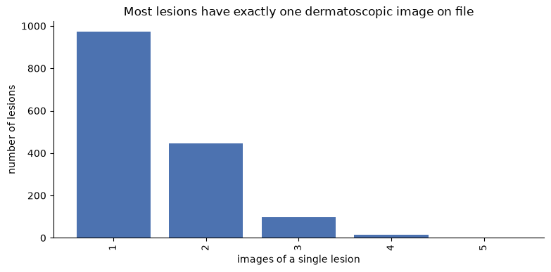
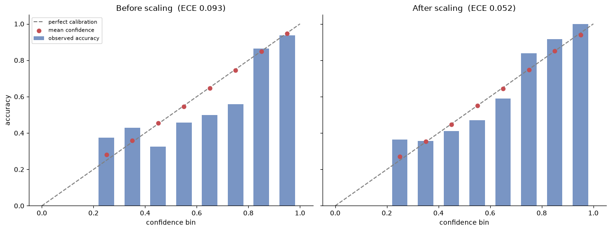

# Can an image classifier catch skin cancer, and can it tell when it should not answer?

A classifier for dermatoscopic images of skin lesions, trained on
histopathology-confirmed cases, with calibrated confidence and a clinically
motivated recall metric.

**This is a portfolio machine learning project, not a diagnostic device.**
It has not been clinically validated and must never substitute for
assessment by a qualified clinician. If you are concerned about a lesion
on your own skin, see a doctor. Nothing in this repository is medical
advice.

## Project background

Dermatoscopic images are close-up photographs of skin lesions taken with a
magnifying dermatoscope. Telling melanoma from a benign mole in one image is
hard even for trained dermatologists, and the cost of error is lopsided: a
false alarm is an unnecessary biopsy, while a missed melanoma is a missed
cancer. This project asks how far a small, honestly evaluated model gets
on [HAM10000](https://doi.org/10.7910/DVN/DBW86T), and where it falls short.

The pipeline runs from data acquisition on Harvard Dataverse to a Streamlit
app, and covers three areas:

- **Honest evaluation:** a split grouped by lesion, plus macro-F1 and malignant recall instead of accuracy alone
- **Model choice:** a frozen DINOv2 foundation model with a linear head, trained on 1,557 images
- **Trustworthy confidence:** calibration and an abstain threshold, tested against the cases that matter most

Links to the technical work:

- Lesion-grouped, leakage-free splits: [src/skinlesion/data/splits.py](src/skinlesion/data/splits.py)
- Malignant recall and other metrics: [src/skinlesion/evaluation/metrics.py](src/skinlesion/evaluation/metrics.py)
- Exploration: [notebooks/01_data_exploration.ipynb](notebooks/01_data_exploration.ipynb)
- Training: [notebooks/02_train_model.ipynb](notebooks/02_train_model.ipynb)
- Evaluation: [notebooks/03_evaluate_model.ipynb](notebooks/03_evaluate_model.ipynb)
- App: [app/streamlit_app.py](app/streamlit_app.py)

## Data structure and initial checks

HAM10000 holds 10,015 dermatoscopic images across seven diagnoses. The
published run uses the 2,259 images from a University of Queensland skin
cancer practice (Cliff Rosendahl's), all confirmed by histopathology; across
HAM10000 as a whole only about 53% of labels are. After dropping `df` and
`vasc` for having too few images, 2,226 images from 1,534 lesions remain
across five diagnoses. A lesion has **1.45 images on average, and 36.6% of
lesions have more than one**, so the split is grouped by lesion:
1,557 training, 336 validation and 333 test images with no lesion in more than
one split.

## Executive summary

The model flagged **82 of 139 malignant or pre-malignant test lesions, a
malignant recall of 0.590**, against top-1 accuracy of 0.562 and top-3
accuracy of 0.916 (chance is 0.200). The most frequent single error is the
dangerous one: melanoma called an ordinary mole, 25 times in 333 test images.
Raising the abstain threshold lifts accuracy to 0.806 but leaves malignant
recall at 0.583, so the model is not safe to use for triage as configured.

## Insights deep dive

### Evaluation design

- **A random image split would have inflated accuracy.** With 1.45 images per
  lesion, follow-up shots of one lesion would land in both train and test.
  `assert_no_leakage` runs before training; the split check in
  [notebook 2](notebooks/02_train_model.ipynb) shows zero overlap, and
  [tests](tests/test_splits.py) prove the guarantee.
- **Plain accuracy would reward calling everything a mole.** Melanocytic nevi
  are the largest class (803 images against 295 for the smallest), so
  evaluation reports macro-F1 (0.486) and training weights the loss by inverse
  class frequency.

### Model results

- **Melanoma is the weakest class: F1 0.265 and recall 0.255.** The model
  catches roughly one in four melanomas outright, while top-3 accuracy of 0.916
  shows the correct diagnosis usually appears somewhere in a shortlist.
- **The recipe that scored 1.000 on nudibranch species reaches 0.562 here.**
  The same frozen DINOv2 and linear head went from 0.774 to 1.000 on the
  [nudibranch-id](https://github.com/cheryltky/nudibranch-id) smoke split. The
  gap is consistent with a harder visual problem: support correlates with F1 at
  r = 0.80 here versus 0.52 there.

### Trustworthy confidence

- **Calibration error fell from 0.093 to 0.052** at a fitted temperature of
  1.290. The model was overconfident before scaling, and no prediction changed.
- **The abstain threshold does not protect malignant recall.** From 0.00 to 0.60
  accuracy rises from 0.562 to 0.806 while malignant recall moves from 0.590 to
  0.583. Recall recovers to 0.800 at a 0.75 threshold and 1.000 at 0.90, but
  only 20.4% and then 5.1% of images are answered.

## Recommendations

For anyone considering a model like this for skin lesion triage, and for
teams building similar classifiers:

- Several images exist per lesion. **Group by lesion before any evaluation, or
  reported accuracy is unreliable.**
- Melanoma called benign is the costly error. **Report malignant recall next
  to accuracy, and tune any threshold against it.**
- The model reached 0.590 malignant recall. **Do not use it to rule out cancer
  or to guide decisions about a real lesion. Use it only as a research
  baseline or to demonstrate evaluation practice.**
- Top-3 accuracy is 0.916 against 0.562 top-1. **If a model like this is ever
  used, present a shortlist for a clinician to review, not a single answer.**
- Confidence is calibrated but still misaligned with malignant errors.
  **Treat the app's abstain option as a limit on how often it answers, not as a
  safety control.**

## Assumptions and caveats

- **Single practice, 333 test images.** Results come from one clinic's
  biopsy-confirmed subset; `df` and `vasc` were dropped as too sparse.
- **Closed set:** anything outside the five diagnoses is forced into the
  nearest known class.
- **Dermatoscope images only,** not ordinary phone photos, which look
  meaningfully different.
- **Skin tone is undocumented.** HAM10000 has no Fitzpatrick skin type
  labels and dermoscopy archives skew toward lighter skin; performance on
  darker skin is untested.
- **Not validated at full scale.** `config/default.yaml` (seven diagnoses,
  10,015 images) has not been run, so whether a frozen head still beats
  fine-tuning there is unknown.

## Technical detail

- How to run it: [docs/SETUP.md](docs/SETUP.md)
- Design decisions, full results tables and tests: [docs/METHODOLOGY.md](docs/METHODOLOGY.md)
- 109 tests, 96% statement coverage

## Data and licensing

HAM10000 is downloaded fresh from Harvard Dataverse
(doi:10.7910/DVN/DBW86T) rather than redistributed here, under its
non-commercial academic use terms. Code in this repository is MIT licensed;
the dataset is not mine to license, and this project is not a medical device.
